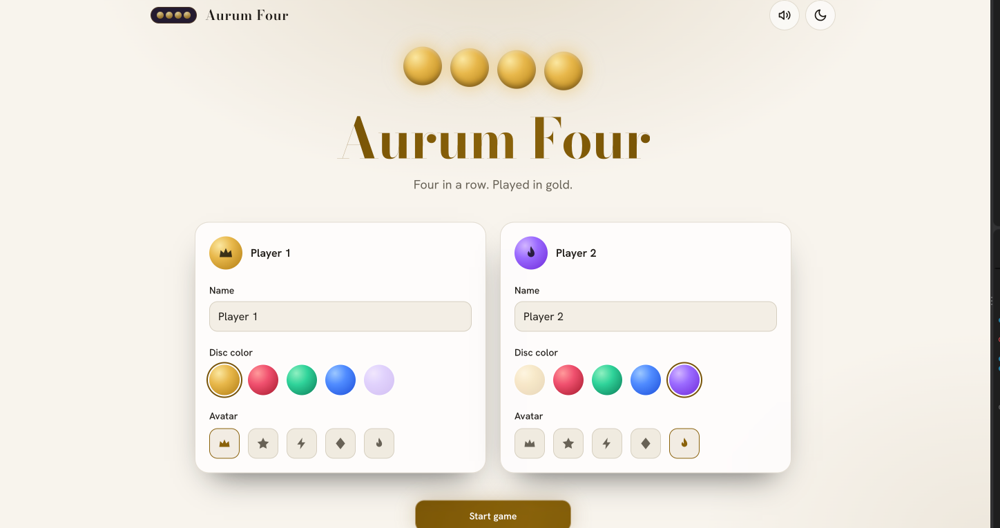
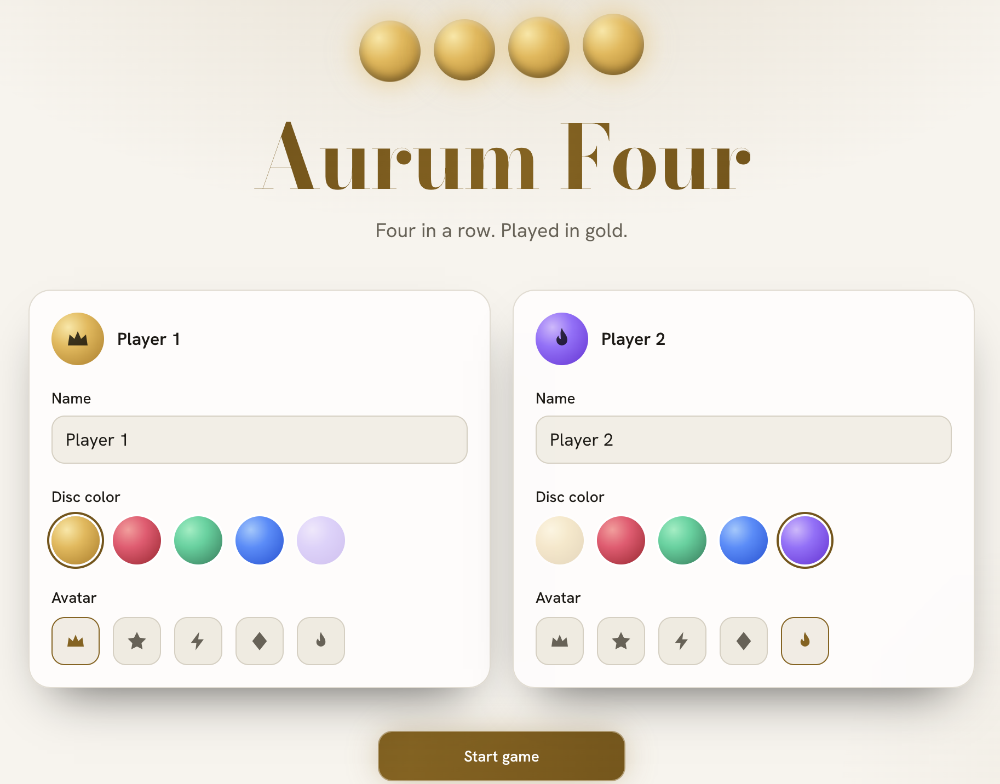
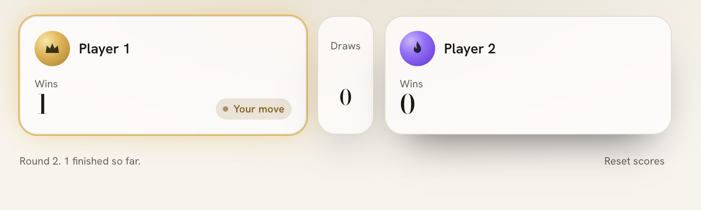
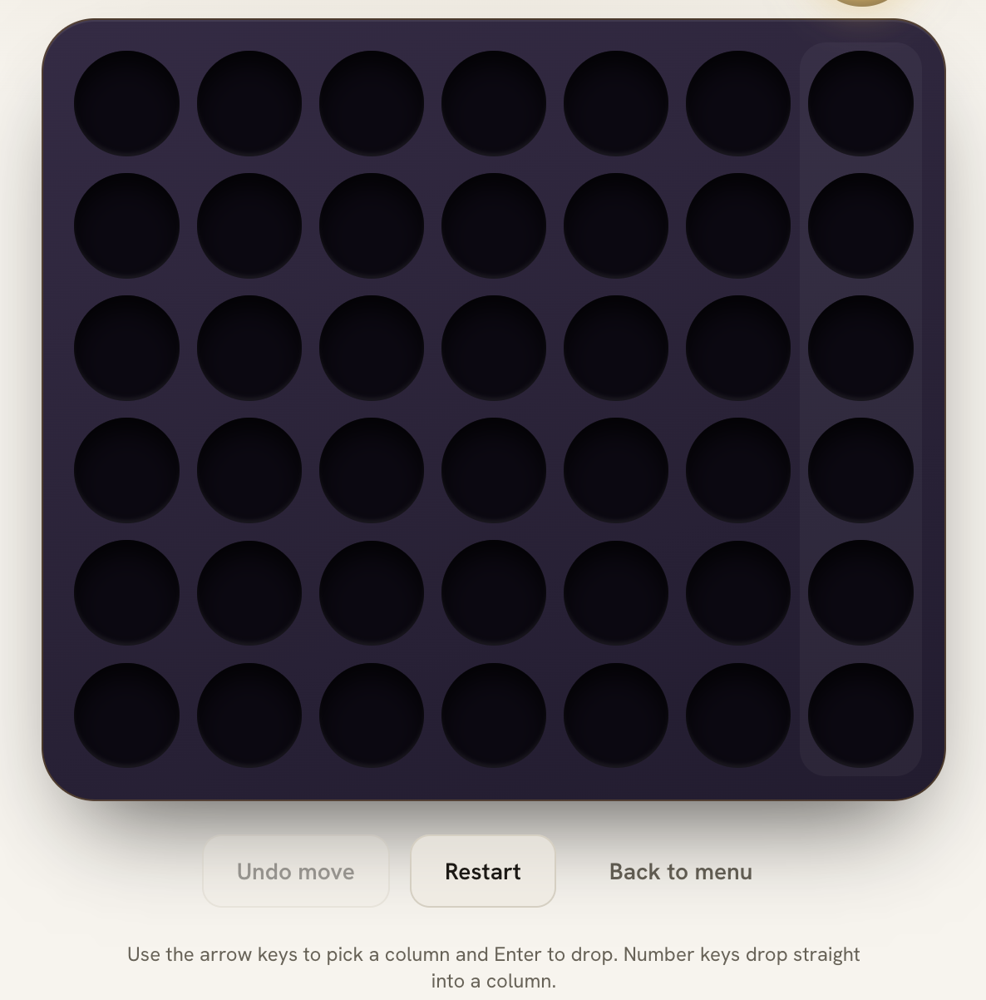
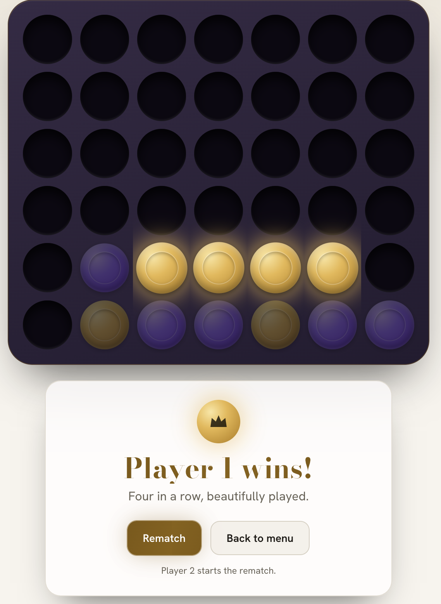

# Aurum Four: Connect Four, in Gold


Aurum Four is a two-player, same-device Connect Four built to be demoed live to a client. The board is a lacquered aubergine-black slab with a gold-leaf edge. Discs drop with spring physics, and every win ends in a confetti burst and a rematch prompt.

It runs entirely in the browser. There is no backend and no database. Only scores, names, theme and mute state are saved, in `localStorage`.

<p align="center">
  
</p>

**Live demo:** `https://your-demo-url.vercel.app`

## Features

- Two players on one screen, 7×6 board, first to four in a row wins
- Spring-physics disc drops with a ghost preview of where your disc will land
- Glowing winning line, confetti burst and a result dialog with a rematch prompt
- Session scoreboard with animated score changes and a reset button
- Undo last move, restart round, rematch (swaps who starts) and back to menu
- Light and dark themes (aubergine-black with gold, warm ivory with bronze)
- Synthesized sound effects with a mute toggle, no audio files
- Invalid moves are handled gracefully with a column shake instead of an alert
- Fully responsive, with 44px touch targets
- Accessible: keyboard play, visible focus rings, screen reader announcements for turns and results, and `prefers-reduced-motion` support

## Screenshots

<p align="center">
  
  
</p>
<p align="center">
  
  
</p>

## Tech stack

| Area       | Choice                                                |
| ---------- | ----------------------------------------------------- |
| Framework  | React with TypeScript (strict mode, no `any`)         |
| Build tool | Vite                                                  |
| Styling    | Tailwind CSS v3.4 with design tokens as CSS variables |
| Animation  | Framer Motion                                         |
| State      | Zustand with the `persist` middleware                 |
| Sound      | Web Audio API                                         |
| Tests      | Vitest                                                |

## Getting started

You need Node.js 20 or newer and [pnpm](https://pnpm.io/installation).

```bash
git clone https://github.com/your-username/aurum-four.git
cd aurum-four
pnpm install
pnpm dev
```

Open `http://localhost:5173`.

### Scripts

| Command        | What it does                                        |
| -------------- | --------------------------------------------------- |
| `pnpm dev`     | Start the dev server                                |
| `pnpm build`   | Type-check and create a production build in `dist/` |
| `pnpm preview` | Serve the production build locally                  |
| `pnpm test`    | Run the unit tests once                             |
| `pnpm lint`    | Run ESLint                                          |

## How to play

1. On the start screen, enter both player names and pick a disc color for each.
2. Click or tap a column to drop a disc, or press the number keys `1` to `7`.
3. Connect four discs horizontally, vertically or diagonally to win the round.
4. Use **Rematch** to play again with the other player starting, or **Undo move** to take back the last disc.

Player 1 opens the first game. Rematch swaps who starts. Restart keeps the same starter.

## Project structure

```
aurum-four/
├─ index.html
├─ vite.config.ts
├─ tailwind.config.js
├─ postcss.config.js
└─ src/
   ├─ main.tsx
   ├─ App.tsx
   ├─ index.css            design tokens and shared styles
   ├─ store.ts             Zustand store and persistence
   ├─ sound.ts             Web Audio sound effects
   ├─ game/
   │  ├─ connectFour.ts    pure game logic, no React
   │  └─ connectFour.test.ts
   └─ components/
      ├─ Setup.tsx
      ├─ Hud.tsx
      ├─ Board.tsx
      └─ ResultOverlay.tsx
```

Game rules live in `src/game` as pure, typed functions, so they can be tested without rendering anything.

## Testing

```bash
pnpm test
```

The tests cover disc placement, stacking, full and out-of-range columns, horizontal, vertical and diagonal wins, an in-progress game, and a draw.

## Customization

- **Colors and theme:** edit the CSS variables at the top of `src/index.css`.
- **Disc colors:** edit the palette array in `src/store.ts`.
- **Fonts:** change the Google Fonts `@import` in `src/index.css` and the font names in the same file.
- **Logo and title:** replace the title text in `src/App.tsx` and `src/components/Setup.tsx`.
- **Board size:** change `ROWS` and `COLS` in `src/game/connectFour.ts`. Keep `COLS` at 9 or below, because keyboard shortcuts use single digits.

## Deployment

The app is a static site, so any static host works.

**Vercel:** import the GitHub repo, keep the detected Vite settings, and deploy.

**Netlify:** build command `pnpm build`, publish directory `dist`.

## Notes

- Google Fonts load from the internet on first visit. Each font has a system fallback, so the game still works offline after that.
- Sound starts only after the first click or tap, because browsers block audio before a user gesture.

## License

MIT. See [LICENSE](./LICENSE).